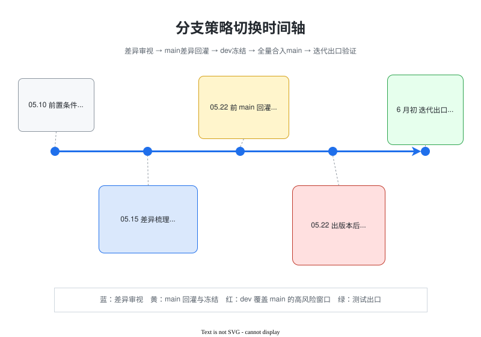

# 分支策略变更计划

## 任务描述

策略：
1、梳理dev和main的差异，关注两部分：1、main比dev多的内容（额外同步） 2、dev比main多的内容（只用作影响审视和测试加固）
责任人：各团队
预计完成时间：05.15
备注：预计10号可提供平台查看PR在双分支的差异。--前端组:王音强

2、main上面比dev多的内容同步提PR到dev，同时main分支新增代码冻结。
责任人：有差异的团队
预计完成时间：05.22前

3、dev分支冻结，dev分支内容全量覆盖到main，版本号变更修改，提交PR合入。
责任人：内核各仓库Owner
预计完成时间：05.22出完版本后，dev冻结，启动全量合入到main（2天）。

4、测试保障：1、常规验证尤其重点保障兼容性验证 2、dev比main多的特性补充保障测试，主要是终端场景下
责任人：测试团队
预计完成时间：迭代二出口前（预计6月初）

## 时间轴说明

下图按关键时间点展示差异审视、main 回灌、dev 冻结、全量合入 main 以及测试出口之间的先后关系。

源文件：[dev-switch-main-timeline.drawio](./figures/dev-switch-main-timeline.drawio)

新发现的遗留问题：
1、后冒烟、性能看护工程等dev冻结后迁移为main分支
2、dev分支当前配套ohos已经发现用例失败问题，需要提前投入分析，争取在22号前完成分析，迭代二出口前修复