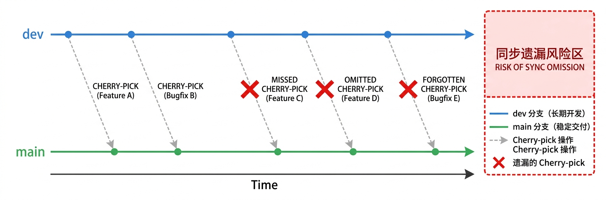

# 仓颉语言社区分支管理策略调整方案

> **议题类型**：技术决策  
> **提交评审**：PMC 会议  
> **核心提案**：废弃 `dev` 分支，采用单主干（`main`）开发模式  

---

## 一、议题概述

本次提案建议将仓颉社区当前的**双主干并行开发模式**（`dev` + `main`）调整为**单主干开发模式**（仅 `main`）。

**核心提案：

- 冻结并最终废弃 `dev` 分支，确立 `main` 为唯一长期开发主线
- 明确实验特性的开发和配套的门禁策略

---

## 二、现状说明

### 2.1 版本发布节奏

| 版本类型 | 发布节奏 | 维护周期 | 说明 |
|---------|---------|---------|------|
| LTS | 每年 3 月 30 日 | 初期 1 年，稳定后 2~3 年 | 发布前 1 个月发布预览版本 |
| STS | 每 6 个月 | 6 个月 | 承载新特性，可能存在不兼容变更，收编到下一个 LTS |

### 2.2 当前保护分支

| 分支                                  | 角色         | 说明                         |
| ----------------------------------- | ---------- | -------------------------- |
| `dev`                               | 长期开发分支     | 所有代码、特性、修复优先进入             |
| `main`                              | 稳定交付分支     | 经 `dev` 验证后 cherry-pick 合入 |
| `release/1.0`                       | LTS 1.0 版本 | 等下一个 LTS 发布时收编             |
| `release/1.1`                       | STS 版本     | 等下一个 STS 或 LTS 发布时收编       |
| `release/OpenHarmony-release-6.0`   | 下游商用配套     | 为 OpenHarmony 6.0 配套       |
| `release/OpenHarmony-release-6.0.2` | 临时分支       | 待收编                        |
| `release/v1.0.3-cjmp-beta`          | 临时分支       | 待收编                        |
修改建议： 补充一个分支图，每个分支作为一条时间轴，dev和main两条主线，`release/1.0`、`release/1.1`、`release/OpenHarmony-release-6.0` 三条分支从main拉取，dev上的特性/bugfix同步得到main
### 2.3 核心问题

当前策略的**优点**：

所有非商用的实验性特可以始终停留在dev，避免影响稳定分支（main、release）以及下游版本质量。

缺点：**当前最大痛点：`dev → main` 合入遗漏。**

这是分支结构带来的**系统性问题**，而非执行细心程度问题。只要 `dev` 和 `main` 两条长期主线并存，以下问题就会持续发生：

1. **同步遗漏**：特性或修复在 `dev` 合入后，遗忘 cherry-pick 到 `main`，导致main上的版本出现质量问题
2. **重复验证**：同一变更需要在 `dev` 和 `main` 上分别同步和验证，消耗 CI 资源和人力
3. 代码冲突：代码在两个分支存在差异，同一改动两边需要不同版本（与release相比，dev和main更严重）
4. **责任模糊**：开发者有时候迫于时间紧急，经常会打破“先在dev合入验证，再同步main”的策略，先合入main，既没有起到看护作用，又可能造成dev同步遗漏（dev也在发转测版本）

讨论：当前分支差异内容是什么？




---
## 三、调整方案

### 3.1 废弃dev作为开发主干

| 分支            | 定位                                 | 生命周期             |
| ------------- | ---------------------------------- | ---------------- |
| `main`        | **唯一主干**，所有特性、缺陷修复、重构必须先进入         | 长期               |
| `release/x.y` | 阶段版本冻结、**STS** 维护、下游/补丁线命名可与发布节奏对齐 | 与版本周期一致（如约 6 个月） |
|               |                                    |                  |

**废止**：`dev` 不再作为开发主干；策略上**主干常绿**，重大问题优先**回退**（与 LLVM 文化一致）。

### 3.2 实验特性分级与准入

单主干下实验特性亦需进 `main`，采用**两类**划分

- **可共存型**：在**默认发布配置**下可完整编译、可发布；实验行为仅由**开关**启用；**默认关闭**时不改变约定语义与兼容基线
- **强隔离型**：必须依赖**编译期条件**与默认构建隔离，与默认的正式发布件分叉为两个版本

方案一（建议）：禁止此类特性或代码合入main分支，可经过项目评审单独建立短期项目协作分支以及流水线跟踪，给出分支收编计划和验证看护策略

方案二：允许此类特性代码经评审后合入，但不在默认门禁中进行看护，通过评论或commit msg等约定额外统一按需触发独立的构建看护以及合入后的门禁等。


## 四、业界实践对标

### 4.1 Rust

Rust 采用**发布列车（Release Train）**模型（非LTS版本模型）

**分支模型**：仓库中存在 `master`、`beta`、`stable` 三个分支名，但 **`beta` 与 `stable` 不是第二、第三条「长期开发主干」**——约每 6 周随发布列车**重置指针**：新 `beta` 从当前 `master` **全量快照**；上轮 `beta` **晋升**为 `stable`。其间仅在 `beta` 上做**定向回移**类修补。全部新特性开发仍在 **`master` 这一条主干**上。

**发布列车运作机制**（指针移动，而非日常双向同步）：

1. `stable` 指针 → 移到原 `beta` 位置（晋升）
2. `beta` 指针 → **强制指向当前 `master` HEAD**（非 merge、非全量拣选同步）
3. `master` 继续接受合入，**永不因切 `beta` 而冻结**

```text
                   T0 发布日                            T1 发布日(+6周)
                      │                                     │
master:  ──●──●──●──●─D─●──●──●──●──●──●──●──H─●──●──●──●──►
                       │   (持续开发，永不冻结)        │
                       │                              │
                       ↓ 从 D 切出                    ↓ 从 H 切出
beta:              1.82:D──○──○──┐              1.83:H──○──►
                    (仅回归修复)   │              (仅回归修复)
                                 │ 晋升
                                 ↓
stable:  ──── 1.81 ──────────── 1.82 ─────────────────────────►
```

- **说明**：示意图中 **`stable`/`beta` 刻度**表示「面向用户的稳定/测试轨道」，对应仓库分支指针的晋升与替换；与「在 `master` 同一提交点上再叠两个标签」不同。
- T0：从 `master@D` 切出 `beta/1.82`；上轮 `beta/1.81` → `stable/1.81`
- T0～T1：`master` 继续演进；`beta/1.82` 仅少量回归修复（○）
- T1：`beta/1.82` → `stable/1.82`；新 `beta/1.83` 自 `master@H` 切出


这个机制的核心特征：

| 特征                       | 说明                                                                                               |
| ------------------------ | ------------------------------------------------------------------------------------------------ |
| **master 永不冻结**          | 切出 beta 后 master 照常合入新特性，错过这班车的变更等下一班（6 周后）                                                      |
| **新 beta = master 全量快照** | 不存在"同步"操作，新 beta 在切出那一刻与 master 完全相同，**不可能遗漏**                                                   |
| **cherry-pick 是例外**      | 仅当 beta 测试中发现回归缺陷且严重到不能等 6 周时，才从 master 定向 cherry-pick 修复到 beta，需经 release team 提名和审批，单个周期通常仅十余个 |
| **遗漏可自愈**                | 即使某个 backport 被遗漏，下一个 beta 从 master 切出时自动包含，也可通过 point release 紧急发布                              |
|                          |                                                                                                  |

 Rust 的 `master → beta` cherry-pick 是**例外应急通道**（绝大多数变更不需要搬，偶尔搬几个还有兜底机制）。

**实验特性治理**：

- **构建时不隔离**：Rust 编译器始终构建为一个二进制文件，所有实验特性的实现代码都编译进去
- **隔离在编译器运行时**：编译器内部有 `channel` 标记（nightly/beta/stable），处理用户代码时检查此标记决定是否接受 `#![feature(...)]` 声明。stable 模式下遇到 feature gate 直接报错，但编译器本身的实验特性代码完整存在
- **特性生命周期**：RFC 提案 → 实现并置于 feature gate 之后 → nightly 验证 → **Crater 全生态兼容性扫描** → 稳定化评审 → 移除 gate 进入 stable
- **CI 策略**：每个 PR 只做一次构建，跑一套测试（测试套件中混合稳定特性和不稳定特性的用例），Crater 仅在稳定化评审时触发

### 4.2 LLVM

```text
main ─────────●────●────●────●────●──────────────►
               \              \
release/18.x    ●────●────●────●─────────────────►
release/19.x                ●────●────●──────────►
```

**分支模型**：单主线 + 发布分支冻结。`main` 持续集成，发布窗口到来时切出 `release/x.y`，发布分支只做冻结和补丁。不存在双主干同步痛点。

**实验特性治理**：

- **构建时有隔离**：通过 CMake 选项在编译期进行代码隔离。`LLVM_EXPERIMENTAL_TARGETS_TO_BUILD` 控制实验性后端目标是否被编译，默认构建不编译实验性后端，代码物理上不进入产物。实验性 pass 同理，可通过 CMake 开关控制是否编入
- **隔离的代价——实验代码可能被"悄悄打坏"**：由于默认 CI 不编译实验代码，当其他开发者修改了实验代码所依赖的内部 API 时，默认 CI 仍然通过，但实验代码实际上已无法编译。这是编译期隔离方案的固有弱点
- **缓解机制**：
  - **Post-commit Buildbot**：包含开启实验选项的构建器，在代码合入 `main` 后持续运行，事后发现破坏（非事前阻止，存在时间窗口）
  - **"Revert first" 文化**：发现破坏后优先回退造成问题的提交，保证实验代码不长期处于不可编译状态
  - **实验特性维护者责任**：每个实验性后端/特性有指定维护者，负责定期验证和及时适配内部 API 变更

### 4.3 Go

Go 采用**单主线 + Go 1 大版本发布**与 **`release-branch.go1.xx` 补丁维护线**相结合的模式。

```text
master/main ──────────●────●────●────●───────────►
                       \         \
release-branch.go1.24   ●────●────●──────────────►
release-branch.go1.25        ●────●────●─────────►
```

**分支模型**：日常开发与下一版大版本演进集中在 `master`；某一 Go 1.x **正式发布后**，从该时刻拉出的 `release-branch.go1.xx` 上只做补丁与安全修复，新特性继续在 `master` 推进。分支分化发生在**已发布版本的维护阶段**，而非两条长期开发主干并行承载全量特性，**不产生典型的双主干同步痛点**。

**实验特性治理**：

- **构建时有隔离**：自举阶段（如 `all.bash` / `make.bash`）读取环境变量 `GOEXPERIMENT`，在**编译期**打开或关闭实验路径；源码侧以 `//go:build goexperiment.xxx`（及 `!goexperiment.xxx` 反选）与默认路径隔离。因 Go **自举**，上述机制**同时作用于编译器/工具链自身与用户态相关代码**（与仅控制“用户怎么用编译器”不同）。
- **准入与流程**：实验特性进入主线前须经过 **Proposal**（设计文档、公开讨论、核心团队决策等）。
- **兼容性承诺**：处于 `GOEXPERIMENT` 下的特性**不受 Go 1 兼容性承诺**保护，允许在后续版本中修改或移除。
- **隔离的代价与 LLVM 的共性**：默认自举未启用的实验路径不参与编译时，若其他改动破坏了仅实验路径依赖的内部接口，默认流水线**仍可能通过**；需依赖**带实验配置的自举构建**及维护者看护来收敛，存在**事后发现**的时间窗口（与 LLVM 默认不编实验代码时的风险结构类似，实现手段不同）。

**门禁与构建看护**：

- **默认预提交 TryBot**：跑**标准自举**；TryBot 集偏快、偏常见平台，**通常不会在每一次 CL 上穷尽所有历史 `GOEXPERIMENT` 组合**。
- **预提交显式加强**：作者或 reviewer 根据影响面，可在 commit message 中通过 **`Cq-Include-Trybots`** 指定额外 builder（可含以特定 `GOEXPERIMENT` 自举的 builder）；进入 CQ 后失败将**阻塞合入**。
- **合入后持续看护**：Dashboard 上对**仍在维护的实验**往往长期保留「以 `GOEXPERIMENT=…` **自举后再跑测**」的专项 builder，用于在合入后捕获对实验路径的**回归**（与 LLVM Post-commit Buildbot 的事后捕获角色相近）。
- **实验用例何时执行**：带 `goexperiment.xxx` 的测试仅在**该次自举启用了对应实验**时才会编译与执行；是否覆盖取决于当次 job 的 `GOEXPERIMENT` 与 builder 设计。

是否要为某次变更加跑实验配置，Go 侧现状以**人工判断 + 显式 TryBot 列表**为主，**合入后**由专项 builder 矩阵兜底，**并非**“每条 PR 自动跑满全部实验矩阵”。


### 4.4 Swift

```text
main ────────────●────●────●────●────●───────────►
                  \         \
release/6.2        ●────●────●───────────────────►
release/6.3              ●────●────●─────────────►
```

Swift 的 snapshot/toolchain 构建承担预览验证职责，类似 Rust 的 nightly 通道，是构建产物而非独立开发分支。

**分支模型**：单主线 + 快照构建 + 发布分支。验证态放到构建和发布节奏中，不引入额外开发主线。不存在双主干同步痛点。

**实验特性治理**：

构建时不隔离。 与 Rust 类似，Swift 编译器构建为一个二进制，所有实验特性的实现代码都编译进去。-enable-experimental-feature 是用户调用编译器时传入的运行时选项，编译器内部判断是否激活对应逻辑。

CI 同样是一次构建，测试用例中通过 -enable-experimental-feature 标志分别测试实验特性和非实验特性。

---

## 五、决议事项

请 PMC 审议以下事项：

1. **是否同意**将仓颉社区分支模型从双主干（`dev` + `main`）调整为单主干（仅 `main`）？
2. **是否同意**引入实验特性双门禁机制作为单主干模式的配套措施？

---


## 参考

- Rust Release Train 模型（nightly → beta → stable）
- LLVM 主线常绿与发布分支冻结实践
- Go Release Policy 与补丁维护机制
- Swift 项目发布与 toolchain/snapshot 实践
